# SkoposIDE

SkoposIDE is a source-available desktop Kubernetes IDE built with Tauri 2, a
Rust core and a React UI, free to use for people and companies alike. It reads
your kubeconfig files, connects to several clusters at once and lets you switch
between them from a hotbar.

Project site, with downloads for Linux, macOS and Windows:
https://skopos-ide.app/

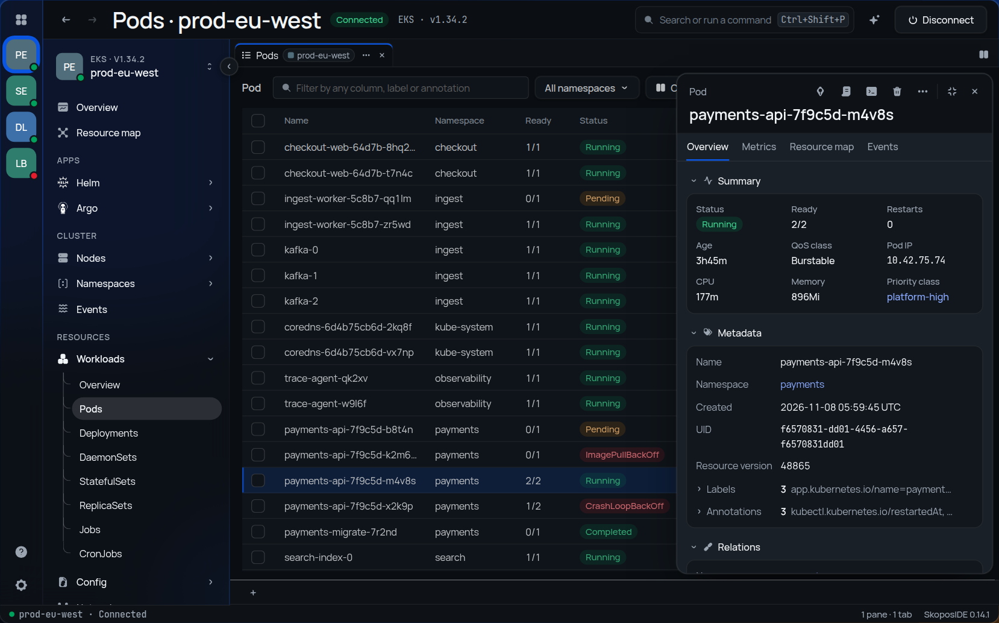

## Screenshots

<table>
  <tr>
    <td width="50%" valign="top">
      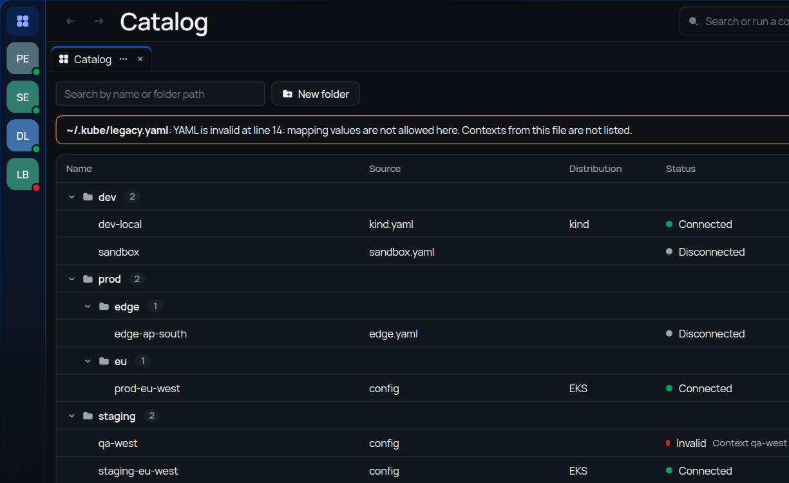<br>
      <b>Every kubeconfig, one catalog</b>
    </td>
    <td width="50%" valign="top">
      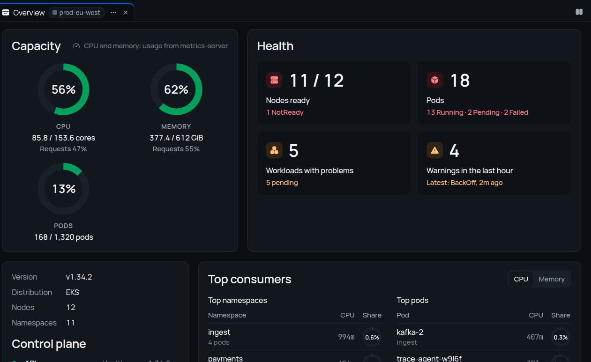<br>
      <b>A cluster at a glance</b>
    </td>
  </tr>
  <tr>
    <td width="50%" valign="top">
      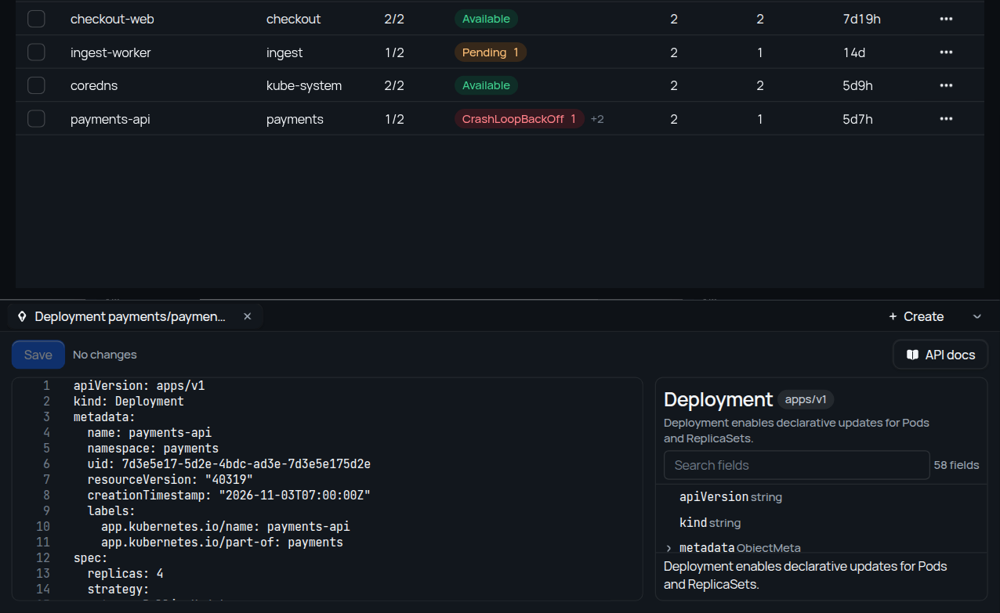<br>
      <b>YAML beside the API docs</b>
    </td>
    <td width="50%" valign="top">
      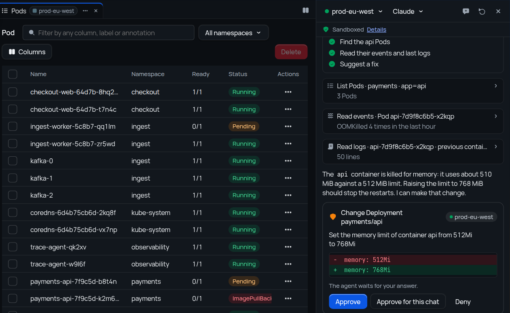<br>
      <b>AI agents that ask first</b>
    </td>
  </tr>
  <tr>
    <td width="50%" valign="top">
      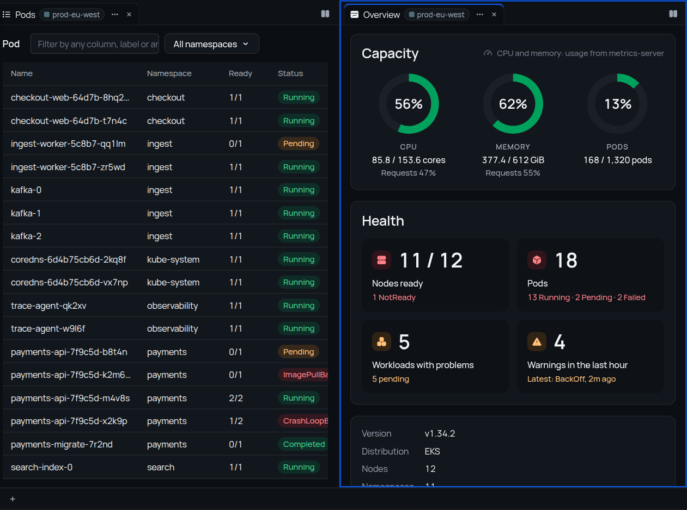<br>
      <b>Tabs, splits and windows</b>
    </td>
    <td width="50%" valign="top">
      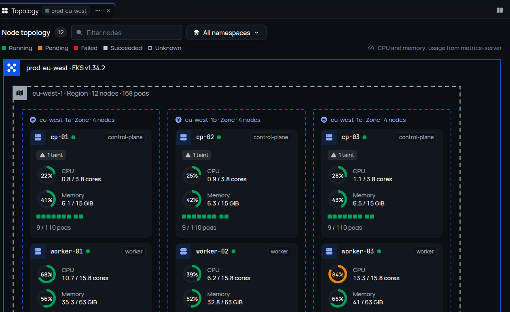<br>
      <b>Node topology</b>
    </td>
  </tr>
  <tr>
    <td width="50%" valign="top">
      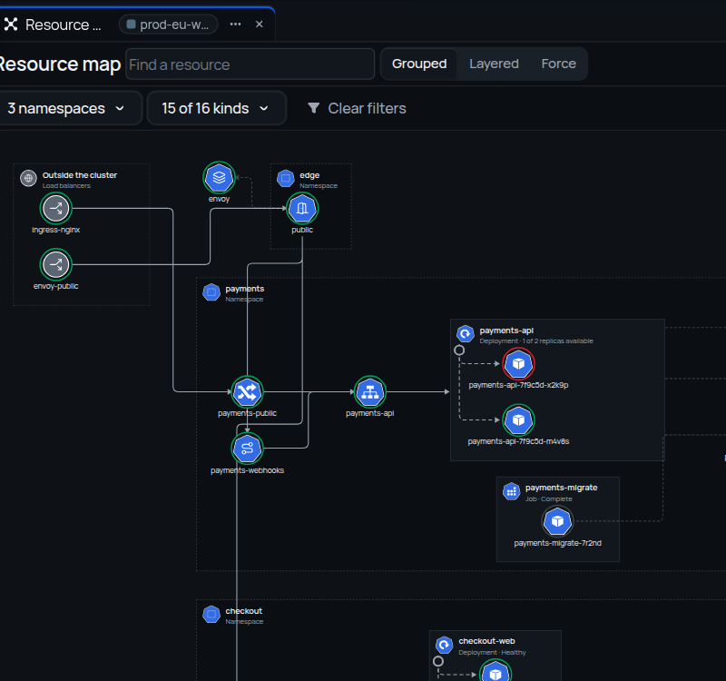<br>
      <b>Resource map</b>
    </td>
    <td width="50%" valign="top">
      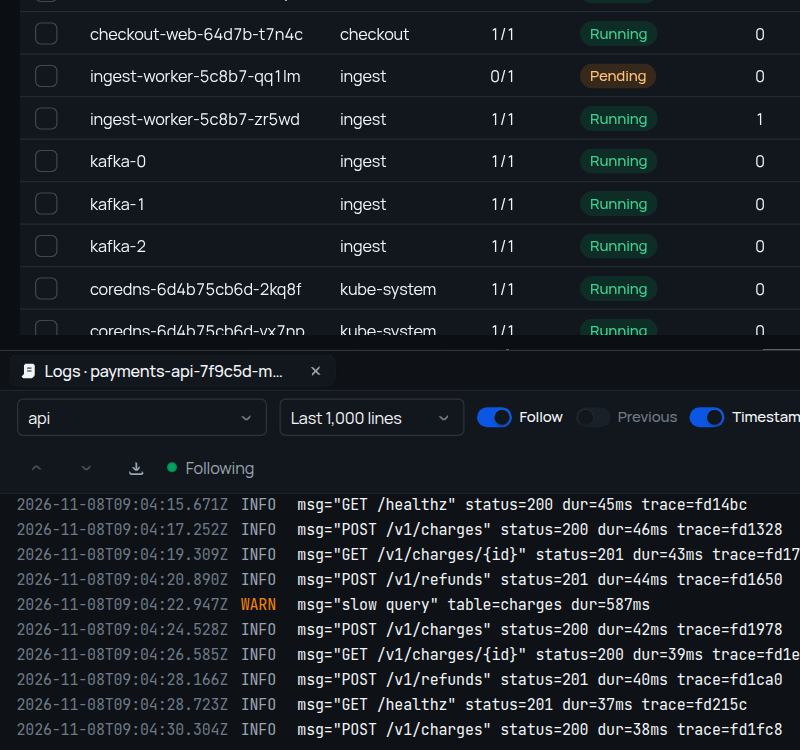<br>
      <b>Logs, shell and port forward</b>
    </td>
  </tr>
  <tr>
    <td width="50%" valign="top">
      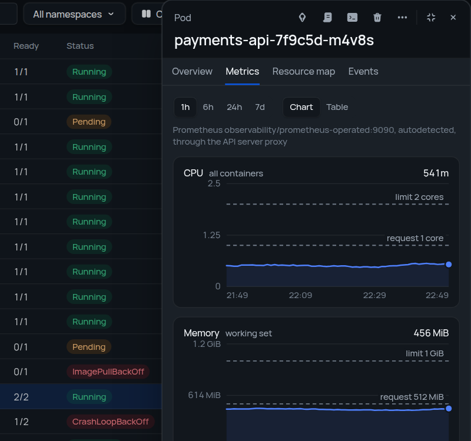<br>
      <b>Metrics where you look</b>
    </td>
    <td width="50%" valign="top">
      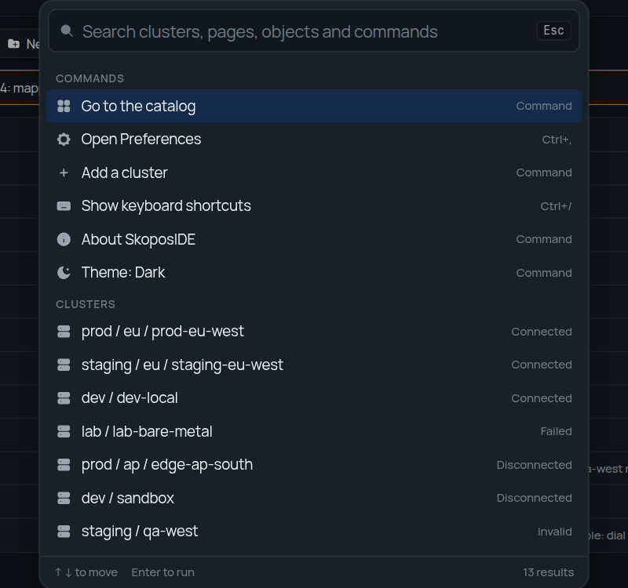<br>
      <b>Keyboard first</b>
    </td>
  </tr>
  <tr>
    <td width="50%" valign="top">
      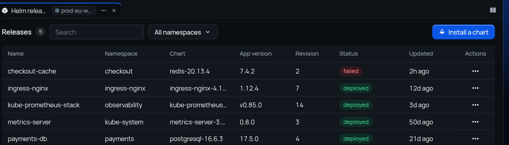<br>
      <b>Helm releases</b>
    </td>
    <td width="50%" valign="top">
      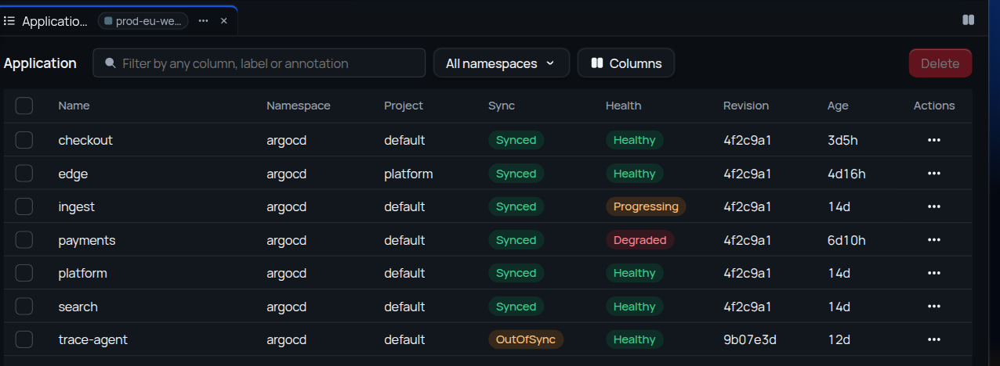<br>
      <b>Argo CD Applications</b>
    </td>
  </tr>
</table>

## Status

SkoposIDE is in active development; [CHANGELOG.md](CHANGELOG.md) lists what each release
added. Today it provides:

- **Catalog and clusters:** your kubeconfig files are watched and synced into a catalog with
  folders and a hotbar. Several clusters connect at once, and one failing never affects
  another.
- **Shell:** a sidebar, tabs across several windows that come back on restart, split panes, a
  command palette and a dock.
- **Resources:** live tables per kind with their own columns, status badges and a filter on any
  column, a detail drawer with actions, a YAML editor to edit and create objects, cluster
  overviews, a resource map and a node topology.
- **Sessions:** logs, local terminals, and Pod and node shells in the dock.
- **Port forwards:** saved definitions, bound to `127.0.0.1` only, that never start on their own.
- **Helm and Argo CD:** repositories, charts and releases through the `helm` CLI; Argo CD
  Applications and their actions.
- **Metrics:** Prometheus or metrics-server, detected per cluster, for charts, usage bars and
  overview cards.
- **Access control:** RBAC kinds, checks of the verbs your account may use, and ServiceAccount
  kubeconfigs.
- **AI agents:** chats with the agent CLIs you installed (Claude Code, Codex, OpenCode, Gemini
  CLI or your own) over ACP. Agents run the installed CLIs as you on Linux, macOS and Windows,
  and each chat gets a kubeconfig with only its clusters. The app's own tools ask before each
  change by default, and the agent asks in the chat before it runs its own commands.
- **Tools and updates:** managed `helm` and `kubectl` downloads, and signed in-app updates.

See [docs/roadmap.md](docs/roadmap.md) for what comes next.

## Prerequisites

All platforms: Rust (stable), Node.js 22, pnpm.

- **Linux**: `libwebkit2gtk-4.1-dev libgtk-3-dev libayatana-appindicator3-dev
  librsvg2-dev libsoup-3.0-dev patchelf`, plus `xvfb` for end-to-end tests.
- **macOS**: Xcode command line tools (`xcode-select --install`).
- **Windows**: Microsoft C++ Build Tools, WebView2 (included in Windows 11) and
  Git Bash, which provides the shell for `make` targets.

Integration tests also need Docker and [kind](https://kind.sigs.k8s.io/).

## Develop

```sh
pnpm install
make dev        # run the app with hot reload
make check      # fmt, clippy, Rust and UI tests, type checks, provenance
make test-kind  # integration tests against a kind cluster (needs Docker)
make e2e        # end-to-end tests (needs Docker and kind)
make e2e-smoke  # smoke end-to-end tests, no Docker
```

## Repository layout

- `crates/` Rust workspace: `skopos-core` (no Tauri dependency),
  `skopos-app` (the Tauri shell) and `skopos-fakekube` (a fake API server
  for tests).
- `ui/` React front end.
- `e2e/` WebdriverIO end-to-end specs and helpers.
- `scripts/` helper scripts (kind setup, provenance check, project site build).
- `site/` the project site, deployed to GitHub Pages (see `docs/releasing.md`).
- `docs/` roadmap, specs and plans.

## First run

- **macOS**: builds are signed with a Developer ID certificate and notarized by Apple. Drag the app to Applications and open it.
- **Windows**: install SkoposIDE from the [Microsoft Store](https://apps.microsoft.com/detail/9PC8GNRRQB5Q),
  which signs it, so Windows shows no warning. The installer from the releases page is not signed
  yet: in SmartScreen choose "More info", then "Run anyway". Install one of the two: both use the
  same settings.
- **Linux**: mark the AppImage executable with `chmod +x` and run it.

## Updates

SkoposIDE asks github.com for `latest.json` of the newest release 10 seconds after it starts
and every 6 hours. Preferences > Updates turns this off, and Check for Updates… in the Help
menu asks at once. When a newer release is out, a toast and a button in the status bar offer
it. The update dialog shows the release notes; Install and Restart downloads the update,
checks its signature, installs it and restarts SkoposIDE with its windows and tabs.

- **macOS**: the app must be in Applications. A copy run from the disk image can't update
  itself. After an update, macOS may ask again for the passwords SkoposIDE keeps in the
  Keychain, because each build has its own ad-hoc signature; choose Always Allow.
- **Windows**: the Store updates the Microsoft Store build, which never checks by itself. For
  the build from the releases page, the installer closes SkoposIDE, installs the update and
  starts it. If the installer fails after SkoposIDE has closed, start SkoposIDE again: the old
  version is still installed.
- **Linux**: the AppImage replaces itself. The deb asks for your password to install the
  package. Other packages can't update themselves.

## License

SkoposIDE is source-available under the [PolyForm Shield License 1.0.0](LICENSE), not open
source. Copyright Nguyen Van Long. Anyone, people and companies alike, may use it free of
charge, change it and share it, but not to provide a product that competes with SkoposIDE or
with a product its licensor provides using it. [LICENSE](LICENSE) has the exact terms.

Third-party code, icons and packages keep their own licenses; their credits and license texts
are in [THIRD_PARTY_NOTICES.md](THIRD_PARTY_NOTICES.md).
